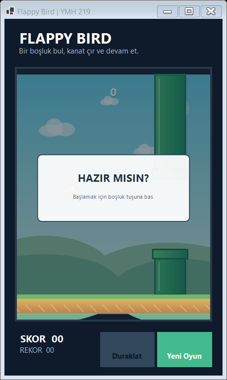
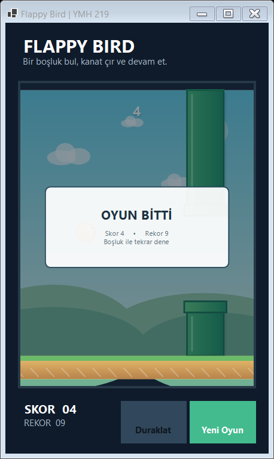

# YMH219 Flappy Bird

Windows Forms üzerinde geliştirilen, klavye ve zamanlayıcı tabanlı Flappy Bird benzeri bir masaüstü oyunu.

## Teknolojiler

- C# ve .NET 10
- Windows Forms
- Harici NuGet paketi yok

## Özellikler

- Boşluk veya yukarı ok ile kanat çırpma
- Yer çekimi ve boru engelleri
- Borulardan geçişte skor
- Boru ve zemin çarpışma kontrolü
- Duraklatma ve yeniden başlatma
- Yerel en yüksek skor kaydı

## Çalıştırma

Windows ve .NET 10 SDK ile:

```powershell
dotnet run --project YMH219-FlappyBird.csproj
```

Visual Studio'da `YMH219-FlappyBird.csproj` dosyasını açıp F5'e basabilirsiniz.

## Kontroller

- **Boşluk / Yukarı ok:** Başlat veya kanat çırp
- **P:** Duraklat / devam et
- **Enter:** Yeni oyun

## Ekran görüntüleri

- `screenshots/gameplay.png` — oyun ekranı
- `screenshots/game-over.png` — oyun sonu ekranı

## Proje yapısı

- `Models/` — kuş ve boru nesneleri
- `GameEngine.cs` — oyun durumu, fizik ve çarpışma kuralları
- `GameCanvas.cs` — oyun sahnesinin çizimi
- `MainForm.cs` — Windows Forms arayüzü ve olaylar

## Geliştirme notları

Oyun döngüsü Windows Forms `Timer` ile çalışır. Oyun mantığı `GameEngine` içinde; çizim `GameCanvas` içinde tutulur. En yüksek skor, kullanıcı uygulama verisi klasöründeki yerel bir dosyaya yazılır.

## Öğrenci bilgileri

- Ad Soyad: [Adınızı yazın]
- Öğrenci No: [Numaranızı yazın]
## Ekran görüntüleri

### Hazır / oynanış ekranı



### Oyun sonu ve skor


